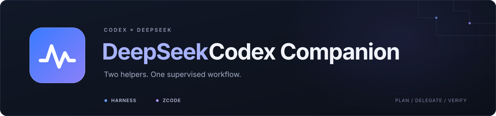

<div align="center">

<picture>
  <source media="(max-width: 640px)" srcset="docs/readme/hero-compact.svg" />
  
</picture>

<p>
<strong>让 Codex 统筹，让 DeepSeek 与 GLM 协作。</strong><br />
<sub>双路受控委派 · 实时进度 · 独立复核</sub>
</p>

<p>
<a href="package.json"></a>
<a href="#环境要求"></a>
<a href="#harness-与-zcode-的双路分工"></a>
<a href="#harness-与-zcode-的双路分工"></a>
</p>

<p>
<a href="#安装"><strong>快速开始</strong></a> &nbsp;·&nbsp;
<a href="#每次任务先加载协作规则">自动协作 Hook</a> &nbsp;·&nbsp;
<a href="#协作方式">协作方式</a> &nbsp;·&nbsp;
<a href="docs/dual-dispatch-validation-2026-10-18.md">验证记录</a> &nbsp;·&nbsp;
<a href="docs/deepseek-capability-evaluation-2026-10-13.md">能力评估</a>
</p>


<br />
<sub> · <a href="https://github.com/swat22544">swat22544</a></sub>

</div>

<div align="center">
<table>
<tr>
<td align="center" valign="top" width="32%">
<strong>01 · 双路协作</strong><br />
<sub>Harness 与 ZCode 各司其职，<br />独立工作包默认并行推进。</sub>
</td>
<td align="center" valign="top" width="32%">
<strong>02 · 实时监看</strong><br />
<sub>公开回复、活动与结果，<br />集中呈现在 Codex 面板。</sub>
</td>
<td align="center" valign="top" width="32%">
<strong>03 · 按需委派</strong><br />
<sub>任务 Hook 先加载规则，<br />Codex 判断分工并复核候选。</sub>
</td>
</tr>
</table>
</div>

<p align="center"><sub>Windows · Node.js ≥ 20 · 版本 1.4.1</sub></p>

## 项目概览

`deepseek-helper` Skill 负责受控委派，`deepseek-monitor` 插件负责展示公开回复、工具活动与状态。Codex 决定任务和范围，Harness 中的 DeepSeek 与 ZCode 中的 GLM 提供候选稿，Codex 独立复核后再执行和采纳。

当前版本 **1.4.1**，Skill 修订 **`2026-10-25-model-settings`**。技能名称、插件身份与安装路径保持稳定，便于现有任务 Hook 自动读取新版规则。当前仅提供 Harness 和 ZCode 两个后端。

这是 Windows 本地外部代理集成，不是 Codex 原生子代理线程。它不附带模型、账号、密钥或第三方应用程序。

## 协作方式

### Harness 与 ZCode 的双路分工

| 后端 | 模型与思考强度 | 调用入口 |
| --- | --- | --- |
| `harness` | DeepSeek-V4.1-Flash-1017 / Max；`deepseek-official / deepseek-flash / max` | DeepSeek Harness 后台 CLI |
| `zcode` | Z.ai API / GLM-5.3-Flash / 高（high）；`zai-standard-api / GLM-5.3-Flash / high` | ZCode 自带 CLI 的 `app-server --stdio` |

ZCode 固定使用标准 Z.ai API：`https://api.z.ai/api/paas/v4`，协议为 Chat Completions。会话模型、思考等级及实际请求分别核验，不根据桌面下拉框推断已经生效，不自动改用 Coding Plan、其他提供方或模型。

两个材料充分、接口明确、没有相互依赖的工作包默认分别委派给两路，通过 `delegate-batch.mjs` 一次启动。每路通常同时一个任务，分别保存请求、会话、预算、候选和结果。同一实现不重复派发。主代理同时推进独立工作，收到候选后核验，再按需提供反馈继续迭代。

只有一个包时也会显式选路：续作优先原后端；一路忙碌时优先可用的空闲一路；没有其他差异时，实现/测试起草优先 GLM，分析/审查优先 DeepSeek。这是起始分配规则，不是能力排名。旧单请求省略 `backend` 仍兼容 Harness，新批次必须明确指定两路。

可直接使用 [双路批次示例](examples/parallel-batch.json)：

```powershell
node skills/deepseek-helper/scripts/delegate-batch.mjs examples/parallel-batch.json work/parallel-results-001
```

父目录 `work/` 须已存在，结果目录须为新目录。两路均在等待结果前启动；每路完成即保存独立 JSON，最后汇总为 `batch-result.json`。一路失败不会重试或自动换后端，也不会丢弃另一路结果。`ok` 仍只表示调用证据机械通过，候选需要独立复核。详细请求字段见 [请求协议](skills/deepseek-helper/references/request.md)。

如果个人 `AGENTS.md` 仍写着“默认 Harness”，应将该条改为与新版技能一致的显式选路和独立包默认双路并行规则；安装器不会擅自修改个人指令。

| 模式 | 权限 | 用途 |
| --- | --- | --- |
| `text` | 仅处理提供的文本 | 比较、假设、草稿 |
| `inspect` | 列出、阅读与搜索指定文件的不可变快照 | 审查、故障分析 |
| `propose` | 快照工具，加隔离候选文件写入 | 实现、测试、补丁、文档 |

辅助代理没有任意终端、项目直接写入、联网工具、凭据操作、插件安装、再委派或自主常驻权限。候选不会自动执行或应用。这是应用层控制，不是操作系统沙箱。

没有“每次任务只能调用一次”的限制。主代理在拆分、实现/测试、新需求和新失败证据出现时重新判断是否适合委派。对同一交付物的同一纠错目标，默认最多追加两轮；不通过改名或切换后端重置次数。简单问答、机械转换及核验成本更高的任务由主代理直接完成。

## 环境要求

- Windows 与 Node.js 20 或以上；本机测试使用 Node.js 24。
- Harness 适配基于 0.2.0-rc.2，程序根目录包含 `DeepSeek Harness.exe`。
- ZCode 适配基于内置 CLI 0.16.9，程序根目录包含 `ZCode.exe` 与 `resources/glm/zcode.cjs`。
- 所需模型已在对应应用中配置并可用。运行器让应用内部复用认证，不把密钥复制到 Skill 或 Hook。
- Codex 支持本地插件与 Skill。自动任务规则需要支持并信任 `UserPromptSubmit` / `SessionStart` Hook。

## 安装

在本仓库根目录运行：

```powershell
node scripts/install.mjs --dsh-home "D:/DeepSeek Harness" --zcode-home "D:/Zcode" --overwrite
```

首次安装可省略 `--overwrite`；更新时先备份原组件。安装器复制 Skill 和插件，保存应用路径，为 MCP 和 Hook 配置当前 Node 路径，并生成本地插件市场。它不登录账号、不调用模型、不修改全局偏好或自动写 Hook 信任。

继续执行安装结果中的 `nextCommands`：

```powershell
codex plugin marketplace add "<输出的 marketplaceRoot>" --json
codex plugin add deepseek-monitor@deepseek-codex-companion --json
```

已经注册为 `deepseek-monitor@local-personal` 时，先通过 `codex plugin list --json` 核对来源，再更新该现有条目，避免重复注册。运行中的监看服务需加载新版文件；位于组件目录之外的监看数据、固定端口及令牌配置保持独立。

| 设置 | 作用 |
| --- | --- |
| `DEEPSEEK_HARNESS_HOME` | Harness 安装根，优先于本地配置，默认 `D:/DeepSeek Harness` |
| `DEEPSEEK_ZCODE_HOME` | ZCode 安装根，优先于本地配置，默认 `D:/Zcode` |
| `helper.config.json` | 安装版 Skill 中保存 `installation` 与 `zcodeInstallation` 两个应用路径，不保存账号或密钥 |
| `DSH_HOME` | Harness 数据目录，默认用户主目录下的 `.dsh` |
| `CODEX_HOME` / `--codex-home` | Codex 的 Skill、插件与监看数据根 |

## 每次任务先加载协作规则

Hook 在每次 `UserPromptSubmit` 时读取已安装的完整 `deepseek-helper/SKILL.md`，并在 `SessionStart` 的 `resume / compact / fork` 时补回规则。它不按会话缓存，不启动模型，不读取或保存用户 prompt，不将用户输入交给后端。是否派遣仍由 Codex 判断。

Hook 使用 `CODEX_HOME`，其次使用安装器生成的运行配置，再使用当前用户默认目录。输入限 1 MiB、Skill 限 32 KiB、输出限 256 KiB；`additionalContextLimit: 0` 配合脚本上限确保完整正文进入上下文。读取失败或内容无效会明确报告，不能声称已加载。

在 Codex `/hooks` 中审核并信任当前定义。若当前宿主未发现插件级 Hook，可以显式登记同一脚本到用户级配置：

```powershell
node scripts/register-task-hooks.mjs --codex-home "<实际 CODEX_HOME>"
```

登记只合并本项目的两个处理器，保留其他 Hook，并备份修改；信任仍通过 Codex 的原生机制审核。不要同时重复启用插件级和用户级处理器。可用 `--remove` 精确移除本项目登记。没有 Hook 时，可采用 [可选协作偏好](examples/AGENTS.deepseek.md)。

## 调用与监看

将 UTF-8 请求写到当前工作目录的 `work/`：

```json
{
  "backend": "zcode",
  "mode": "propose",
  "taskType": "implement",
  "instruction": "按指定契约起草候选文件，使用 helper_write_artifact 保存，不运行代码。",
  "input": "本次接口、边界与交付格式。",
  "files": ["D:/project/contract.txt"],
  "taskSize": "medium"
}
```

```powershell
node "<CODEX_HOME>/skills/deepseek-helper/scripts/delegate.mjs" "<绝对路径>/work/request.json" "<绝对路径>/work/result.json"
```

新请求显式填写 `backend`；仅旧单请求省略时兼容 Harness。完整字段与工具约束见[请求协议](skills/deepseek-helper/references/request.md)。每次使用独立请求和结果文件；材料只提供本次需要的部分，文件名过滤无法识别所有秘密。

首次委派前，Skill 会打开 DeepSeek + GLM Monitor。插件ID仍为 `deepseek-monitor`，面板分别标识 Harness/DeepSeek 与 ZCode/GLM，双模型卡可筛选来源，支持状态和搜索组合。没有加载监看工具时可运行：

```powershell
node "<CODEX_HOME>/plugins/deepseek-monitor/server/launch.mjs"
```

服务仅监听 `127.0.0.1`，用输出的 `url` 打开 Codex 浏览器面板。链接包含本机访问令牌，不应分享。监看只显示公开回复、过滤后的活动与候选元数据，不展示隐藏推理或工具参数。监看中断不证明模型失败，应以结果文件与进程状态核对，不能因监看故障重复请求模型。


双模型总览、来源与状态筛选、公开回复、活动和候选文件。截图使用预览样例，真实调用证据见下方验证记录。

## 时间预算与验收

小、中、大任务的总时限 / 无进展时限分别为 **5 / 3、20 / 7、45 / 10 分钟**。可按实际复杂度显式选择 `taskSize`，独立时限最多 60 分钟。旧 `timeoutMs` 仍是显式总时限；要使用自动分档，应省略它。两路独立计时，面板刷新与心跳不会续期，所有进展也不会延长总预算。[时间预算说明](skills/deepseek-helper/references/timeouts.md)

验收分三层：

1. 调用完成：检查退出码、后端、固定模型、运行证据、完成原因、工具记录与进程清理。
2. 交付符合契约：候选代码、解释、源码引用、边界示例和测试预期分别独立核验。
3. 主代理决定采用：只采用已核验部分，运行必要测试后才应用；测试通过不等于已经应用。

`verify-result.mjs` 只做机械检查，不执行或采纳候选。[机械检查器说明](skills/deepseek-helper/references/verification-contract.md)

ZCode 失败诊断保留固定白名单错误类型、实际 HTTP 状态与来源，不保存原始错误正文、响应体、请求头、密钥或隐藏推理。缺失信息保持未知；不会自动重试、切换后端或改凭据。[错误诊断说明](skills/deepseek-helper/references/diagnostics.md)

## 验证与能力边界

运行正式离线测试：

```powershell
node scripts/test.mjs
```

测试入口只枚举正式测试目录，避免执行 `work/` 中的候选文件。离线故障注入、Hook 触发、真实模型调用和候选语义验证分别报告，不用其中一项代替另一项。

2026-10-18 的 1.4.1 长响应修复通过 **242/242 离线测试**，包含旧 8 MiB 限额反例、跨限额流式输入、错误诊断全链路与取消竞争；本地模拟不代表真实长连接已经通过服务端验收。[长任务排查记录](docs/zcode-long-stream-validation-2026-10-18.md)

2026-10-18 的 1.4.0 本地验收：**227/227 离线测试通过**；新版批次入口的 Harness 与 ZCode 真实任务相隔约1毫秒启动、分别完成并通过机械核验；运行中取消测试确认两路进程树清理完成。交付语义另行核验：审查结论已复现；测试候选的一个异常输入边界不符合契约，未原样采用。浏览器检查覆盖双路筛选、空结果、键盘页签、深浅主题和320–1280像素布局，未做真实手机验收。[双路调度与面板验证记录](docs/dual-dispatch-validation-2026-10-18.md)

此前2026-10-15的1.3.0接入验收为 **215/215 离线测试通过**、原生 Codex 两轮 Hook 全文注入通过，以及一次真实 ZCode 候选交付通过 **54/54 独立边界用例**。这些均为限定范围的验收，不是模型的一般可靠率。

[DeepSeek 受控辅助能力评估](docs/deepseek-capability-evaluation-2026-10-13.md) 只覆盖当时的 Harness 与 DeepSeek 组合，不能推定 GLM 的可靠性。一次调用成功不等于全面能力评估，也没有据此宣称节省额度或提速比例。ZCode 迁移及本地安装验收见[本次验证记录](docs/zcode-migration-validation-2026-10-15.md)。

本地请求、结果、快照、候选和服务令牌不发布到仓库。主代理选定的材料会发送到所选后端对应的模型服务。本项目与 OpenAI、Codex、DeepSeek、DeepSeek Harness、Z.ai 或 ZCode 官方发布无隶属关系。
