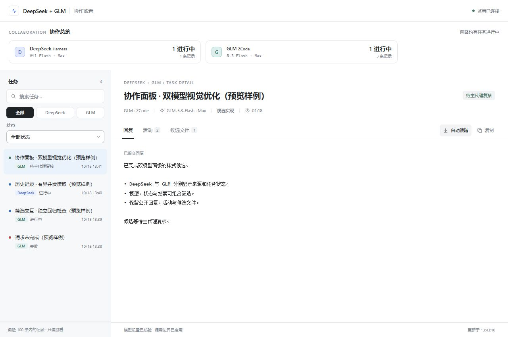

# 1.4.0 双路调度与协作面板验证

日期：2026-10-18。环境：Windows、本机 Harness 与 ZCode，代码基线 `682a182`。本记录区分代码检查、真实调用、候选验收、浏览器检查和本机安装，不将任一项视为模型的一般可靠率。

## 问题与修复

| 原有行为 | 修改 | 原因 |
| --- | --- | --- |
| Skill 与偏好示例反复写“默认 Harness”，ZCode 被放在第二路 | 两路平等可选，每阶段先明确工作包和后端 | 避免一次遗漏 `backend` 就沿用兼容默认值 |
| 并行仅是允许选项，单次入口容易启动一路后立即等待 | 增加 `delegate-batch.mjs`，两份独立请求预检后同时派发 | 用可直接执行的入口落实并行分工 |
| 本机个人指令也包含旧默认 | 经本次任务授权，备份并更新相关条款；安装器仍不修改个人指令 | 避免上层偏好继续将路由引回 Harness |
| 面板展示以 DeepSeek 为主，来源不易比较 | DeepSeek + GLM 显示名、双模型总览、来源与状态筛选 | 同时观察两路，并清楚区分记录来源 |
| 历史列表同时读取所有文件，再排序所有摘要 | 最多8个并发读取，只保留最新100份摘要 | 限制同时进行的文件读取及保留摘要数量；仍扫描历史候选文件 |

单包无其他适配差异时，实现/测试起草优先 ZCode，分析/审查优先 Harness；续作优先原后端，有一路忙碌则考虑空闲一路。两个已就绪、互不依赖的包默认双路并行。依赖任务继续串行，不人为拆包凑比例。

旧单请求省略 `backend` 仍兼容 Harness；新批次必须显式声明两路。入口不提供自动重试、故障切换或跨进程全局队列，调用方仍需确认每路是否空闲。原权限、模型/Max 核验、独立预算和候选复核边界保留。

## 代码与独立检查

- 修改前：215/215 正式离线测试通过。
- 修改后：227/227 正式离线测试通过，0失败、0跳过。
- 新增覆盖：两路先启动再等待、部分失败保留另一结果、错误模型/清理证据不能伪装成功、快照和目标目录预检、取消传递、非法及保留ID；历史记录读取上限、最新100条、同时间稳定顺序、损坏记录；UI组合筛选与轮询保持选择。
- 独立前向试用验证了单包实现、双包并行、先诊断再修复三种路由。发现 `batch-plan` / `batch-result` 与输出文件名冲突，已在调用前拒绝并加入回归。
- `skill-creator` 的技能结构检查通过。

## 真实双路调用

先同时派发两个实际开发包：Harness 起草历史读取优化，ZCode 起草面板 CSS。两路均在 `propose` 隔离目录交付，分别完成模型与边界核验，未自动采用。主代理阅读候选、核对快照/产物哈希、检查测试预期并执行回归后集成。修正了历史测试候选中一个与注释矛盾的时间构造，以及浏览器发现的320像素卡片挤压。

随后直接运行仓库的 `examples/parallel-batch.json`，验证新入口，而非仅验证旧单次入口：

| 后端 | 入口派发时间（UTC） | 完成时间（UTC） | 固定模型核验 |
| --- | --- | --- | --- |
| Harness | 05:39:47.126 | 05:40:17.366 | `deepseek-official / deepseek-flash / max` |
| ZCode | 05:39:47.127 | 05:40:41.038 | `zai-standard-api / GLM-5.3-Flash / max`，`runtimeEvidenceVerified=true` |

入口派发间隔为1毫秒，两路运行时间重叠；这不是模型推理起点的精确测量，也不能据此承诺提速或省额度比例。两条调用均退出0，策略和模型核验通过，`stopReason=completed`，`cleanup.incomplete=false`。独立结果和批次汇总均保存成功。

候选语义另行检查：

- Harness 指出的重试上界错误，由主代理执行两个独立用例复现：全部失败会调用4次；前三次失败后仍可能第四次成功。契约要求最多3次。
- ZCode 的 `formatBytes` 候选通过19个常规/非法输入检查，但对具有抛错 `toString` 的对象，会在应抛 `TypeError` 前抛出其他错误。原稿未原样采用；主代理另存去除输入字符串转换的修正版，通过8个针对性回归。该模块仅为调用验收样例，不是产品新增功能。
- 上述例子说明机械调用成功与代码符合契约必须分开判断。

另用新入口启动两路，在运行约8秒后主动取消。两路均返回失败/取消结果，且各自 `cleanup.requested=true`、`treeKillConfirmed=true`、`incomplete=false`。这是主动取消验收记录，不是后端可用性故障。

## 面板浏览器检查

在 Codex 内置浏览器检查默认侧栏、1280、560、390、320像素视口。检查了浅色/深色、模型卡筛选、状态与搜索组合、空结果、键盘方向键切换页签、活动列表和候选文件页。320/560/1280像素的文档宽度与视口相等，未出现横向溢出；320像素卡片修复后品牌信息不再逐词挤压。检查范围内未记录浏览器控制台错误。

截图来自明确标注的合成预览数据，未将个人历史任务或带令牌地址发布到仓库。真实本机服务另行打开，确认新版面板能加载现有记录和本次 GLM 任务。统计只覆盖最近100条内记录，不代表所有历史调用量、后端健康程度或模型同时推理。未进行真实手机触控和性能验收。

## 本机安装与 Hook

- 安装器刷新现有组件，Codex CLI 更新现有 `deepseek-monitor@local-personal`，安装版本1.4.0；未新增重复插件身份。
- 源码与安装版：40份 Skill 文件、24份插件文件哈希一致；生成的 MCP/Hook 路径配置独立处理。安装源与宿主1.4.0缓存的28份文件一致。
- 对安装版 Hook 分别输入 `UserPromptSubmit` / `SessionStart`：完整加载新修订 `2026-10-18-dual-dispatch`，未回显输入提示。此项为 Hook 实际入口检查；本轮未另外开启新原生 Codex 对话来复测宿主注入。
- 安装版 MCP 初始化返回1.4.0，三个工具仍为只读，资源提供双模型新版面板。
- 重载本机 HTTP 服务后健康检查返回1.4.0；持久服务配置哈希保持一致，监听仍限于127.0.0.1。

原1.3.0组件备份保存在本机 `CODEX_HOME/backups/deepseek-companion-1792302335775`。个人偏好旧版备份及原始调用结果、测试日志、局部检查脚本位于本次工作区 `work/dual-route-20261018/`；这些工作文件不纳入仓库发布。回滚应恢复该组件备份、通过现有插件身份重新加载，并重启自有监看服务；不要覆盖服务数据目录。
